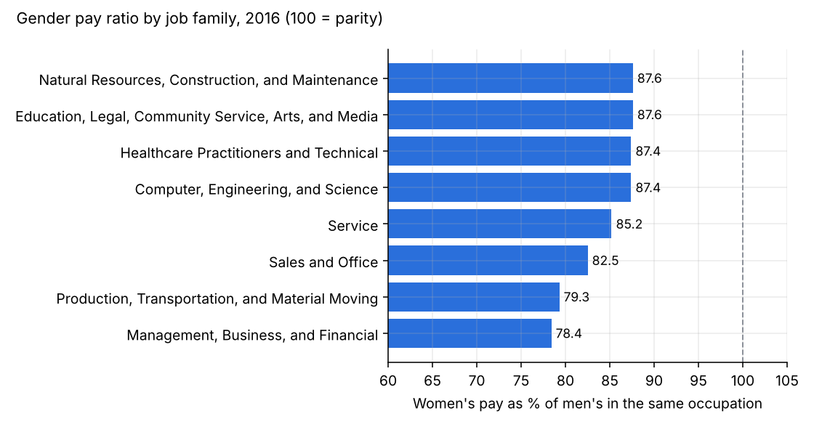

# US workforce pay equity (2010-2020)

I wanted to see how big the gender pay gap in the US really is once you compare people in the same job, and what happened to pay and jobs in 2020. I used public Census (ACS) and BLS (CPS) tables, cleaned them in DuckDB, and built a small dashboard on top.

Tools: SQL (DuckDB), Python (pandas, matplotlib), Chart.js for the dashboard.



## Questions

1. Where is the gender pay gap biggest, and is it getting smaller? (ACS, 2013-2016)
2. How did weekly pay change from 2010 to 2020, and for which groups? (CPS)
3. Which sectors lost the most jobs in 2020, and did women and men lose jobs at the same rate? (CPS)

## What I found

- Overall, women earned 75.9 cents for every dollar men earned in 2016. Inside the same occupation it was 83.1 cents. So roughly 7 points of the gap come from men and women working in different jobs, and around 17 points are still there when the job is the same.
- The within-occupation number barely moved between 2013 (82.3) and 2016 (83.1).
- Management and finance jobs have the biggest gap (78.4). Among big occupations the worst were securities/financial sales agents (50.9), financial managers (61.8, more than 1M workers) and loan officers (65.6).
- Jobs with a mixed workforce (25-50% women) had a wider gap (78.9) than jobs that are mostly men (84.5) or mostly women (89.5). I didn't expect that.
- The gap grows with age. Women aged 20-24 make 93.8% of what men make, at 45-54 it is 77.4% (2020).
- In Q2 2020 median weekly pay went up 10.4% year over year, but the number of full-time workers dropped 11.1%. Pay didn't really jump. Lower-paid people lost their jobs and fell out of the data, so the median went up. Good reminder to always check headcount next to pay.
- 9.7M jobs were lost between 2019 and 2020. Leisure and hospitality alone was 32.5% of that (-21.6%). Women's employment fell 6.5%, men's 5.9%.
- From 2010 to 2020 median weekly pay grew fastest for Asian (+52.6%) and Hispanic workers (+41.5%) and slowest for Black workers (+30.4%).

## If I were on an HR / comp team

- Compare pay within the same job code first. That's the part of the gap a company can actually fix (offers, raises, promotions).
- Start reviews with finance, sales and management roles, and look at how bonuses and commissions are set.
- Look at the gap by tenure or age band. If it opens mid-career, the problem is more likely promotions or return-from-leave than starting offers.
- Don't report a change in median pay without the change in headcount.

## Data cleaning

The employment file had more problems than I expected. Checks are in `sql/02_data_quality.sql` and run every time.

- 330 rows with no industry, and 330 rows where values like "Women" or "Asian" had shifted into the industry column. Dropped.
- 132 industry names with line breaks inside them (so "Mining..." showed up as two different industries). Fixed.
- Sub-industries like "Retail trade" sit next to their parent "Wholesale and retail trade", so summing everything double counts. I kept only the 13 top-level sectors.
- In the ACS file, 69 rows have missing earnings and 934 rows have fewer than 10k men or women. I left those out of the gap rankings because the medians aren't stable.

To check the cleaning I compared my totals to BLS: the 13 sectors add up to 157.54M employed in 2019 and 147.79M in 2020, which matches the published annual averages. For the 2013-2016 trend I only used the 257 occupations that have usable numbers in all four years, so the trend isn't affected by jobs dropping in and out.

## Run it

```
pip install -r requirements.txt
python src/run_pipeline.py
```

This rebuilds everything: the database, the tables in `outputs/tables/`, the charts in `outputs/charts/` and the dashboard data. Then open `dashboard/index.html` in a browser.

## Files

```
data/raw/      original csv files
sql/           01 staging, 02 data quality, 03-05 analysis
src/           run_pipeline.py
outputs/       result tables (csv) and charts (png)
dashboard/     index.html + data.js
```

## Data

- `jobs_gender.csv`: Census Bureau ACS, earnings of full-time year-round workers by occupation and sex, 2013-2016
- `earn.csv`: BLS CPS, median weekly earnings of full-time wage and salary workers, quarterly 2010-2020
- `employed.csv`: BLS CPS, employed people by industry, occupation, sex and race, 2015-2020

I downloaded these from the [TidyTuesday](https://github.com/rfordatascience/tidytuesday) data archive, which republishes the Census and BLS tables.

## Limitations

- Dollars are nominal, not adjusted for inflation.
- The data doesn't include experience, education, hours or location, so the within-occupation gap is not the same as "unequal pay for the same work".
- ACS data stops in 2016 and the CPS earnings data in 2020.
- I average occupation medians weighted by headcount, which is close to but not the same as a real overall median.

Kuat Otarbayev
